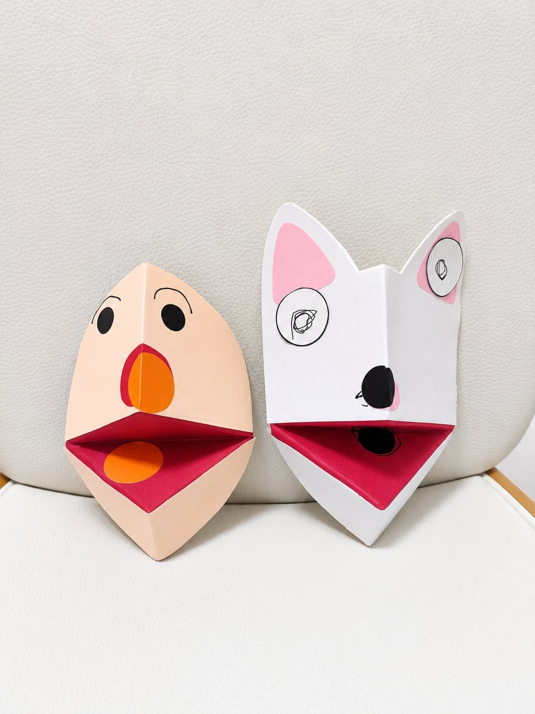
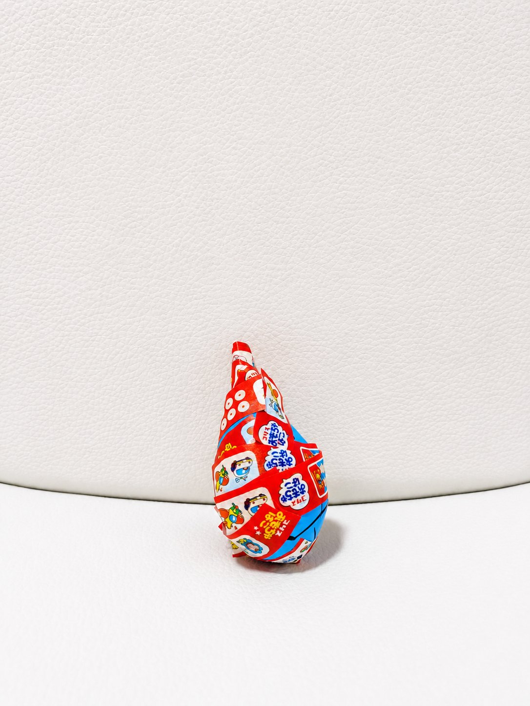

---
{"slug":"tsunagaru-project","id":"tsunagaru-project","title":"顔なじみの先生と、娘の「やりたい」。ももRabiキッズパークのつながるプロジェクト","published":"2026-11-06","period":"2026年11月5日（木）","category":"支援センター巡り","author":"澤本優哉","tags":["子育て","育休","支援センター巡り","制作遊び","ももRabiキッズパーク"],"summary":"顔なじみの先生にほっとして、手遊びの大きなニンジンに感心する父。午前は砂遊び、午後は制作を選んだ2歳の長女と、家族で過ごした一日の記録です。","series_id":"support-center-visits","visit_date":"2026-11-05","center":"道の駅ふくしま・ももRabiキッズパーク","activity":"つながるプロジェクト With ももRabiキッズパーク","play_type":"自由遊び・制作遊び・読み聞かせ","work_ids":[],"article_ids":["support-center-hokushin-halloween-20261028","support-center-watching-over-2026"]}
---
2026年11月5日（木）、道の駅ふくしまの「ももRabiキッズパーク」で開かれた「つながるプロジェクト With ももRabiキッズパーク」に、家族4人で参加しました。

福島市子育て支援センター連絡会が関わり、市内23か所の支援センターが参加する、11月5日・6日の催しです。私たちが参加したのは5日。育休中の私と妻、2歳の長女、次女で、午前10時から11時半、そして予定外の午後12時半から14時まで過ごしました。

## 9時半、知っている先生がいる

混雑を予想して、まずは私と長女の二人で9時半に整理券を受け取りに行きました。会場では、支援センターの先生方がすでに準備を始めています。

その中に、普段から顔なじみの先生がいました。先生もこちらに気づいて、にこっと微笑んでくれます。

それだけで、私はかなり安心しました。

私は普段、福島市内のいろいろな支援センターを利用しています。何度も通ううちに先生と顔なじみになり、少しずつ安心して過ごせるようになります。

ただ、顔を覚えてもらっているから安心する、というだけではないのだと思います。その先生が子どもに優しく接してくれることや、私の育児のやり方をむやみに否定しないことを、これまでの経験から知っている。その安心感です。

例えば、娘がほかの子のおもちゃを取ったとき。初めて会う先生の前では、娘への対応に加えて「今の私の対応、どう思われただろう」と気になることがあります。顔なじみの先生なら、どこまで見守ってよいか、どう接すればよいか、これまで一緒に過ごした経験から自然に判断できるところがあります。

今回の会場には、知らない先生も大勢いました。この先生方とも顔なじみになれたら、もっと楽しく、安心して子育てできるのかもしれません。

## 長女は砂遊び、私は読み聞かせ

10時になると、会場は予想どおりの混雑でした。

普段の遊具で自由に遊べるほか、一画では先生方による制作遊びや絵本の読み聞かせが行われています。

長女は砂遊びに夢中で、制作には参加しませんでした。読み聞かせの時間になっても、まだ遊びたいようで、あまり聞いていません。

一方、私は次女を担当していたので、ゆっくり読み聞かせを楽しめました。長女よりも、父のほうがしっかり聞いていたかもしれません。

## かぶを引っ張ったら、大きなニンジン

読み聞かせを担当したのは、北信の支援センターで顔なじみの先生でした。

本を読む前に、手遊びで子どもたちを引き込む雰囲気を作ります。今回は「大きなかぶ」を模した手遊びです。

先生は物語に合わせたエプロンを身につけ、登場するキャラクターの指人形を次々とエプロンに貼り付けていきます。そして、ポケットから伸びた葉っぱを何度も引っ張ります。

なかなか抜けないかぶ。最後に飛び出したのは、ポケットに入っていたとは思えないほど大きなニンジンでした。

かぶではなく、ニンジン。しかも大きい。ちょっとした手品のような演出でした。

かわいいキャラクターに、工夫された小道具、子どもを引き込む手遊び。あの小道具は全部手作りなのでしょうか。さすが北信の先生だなあと感心しました。[先日のハロウィンでも、遊びの工夫に何度も驚いたところです。](/writing/support-center-hokushin-halloween-20261028/)

顔なじみの先生がこうして活躍していると、なんとなく応援したくなります。まるで「推し」を見ているような気分でした。

## 「食については順調ですか」

午前の部には、福島市で栄養を担当する佐藤正子先生もいらっしゃいました。以前から何度かお会いしている先生です。

顔を合わせると、「あらあら」というような反応でした。「いつもお世話になっております」と挨拶すると、「食については順調ですか」と声をかけていただき、簡単に近況をお伝えしました。

専門家に相談できる機会でありつつ、顔なじみの先生との自然なやり取りでもあります。こんなところでもお会いするんですね、という親しみがありました。

## 先生が多い。何と何がつながるのでしょう

それにしても、先生が多いのです。

読み聞かせを担当する先生はせいぜい二人ですが、利用者の後ろにも大勢の先生がいます。一緒に手遊びをしたり、子どもに微笑みかけたりしていました。

市役所の職員と思われる方々もいて、仁王立ちしていたり、座り込んでいたりする姿が目に入りました。ただ、私にはそれぞれの役割や、その時間に何を担当していたのかは分かりません。

支援センターの先生方同士が談笑する場面もありました。とはいえ、全員がもともと顔なじみというわけでもなさそうです。

「つながるプロジェクト」という名前ですが、親子と支援センターをつなぐ催しなのでしょうか。それとも、先生同士の交流や、施設間の連携にも目的があるのでしょうか。

正式な目的は、まだ確認していません。後日、北信の支援センターの先生に聞いてみたいと思っています。

23か所もの支援センターが参加するとなると、その裏側も気になります。それぞれの施設では、普段の運営も続いているのでしょうか。一人の先生を送り出すだけでも、なかなか大変なのではないかと思いました。

当日の各施設の開所状況や人員配置は知らないので、あくまで想像です。こうしたイベントの準備をいつ進め、普段の仕事とどう両立しているのか。遊びに来た側からは見えないところも、少し聞いてみたくなりました。

会場には、普段から支援センターを利用している親子だけでなく、ももRabiキッズパークを遊び場として訪れた親子もいました。子ども一人を両親二人で見守っている家庭もあります。

妻は、スマートフォンを見ている男性が多いと感じたそうです。私は次女を担当していて、それほど意識していませんでした。何を見ていたのかまでは分かりませんが、同じ会場にいても、夫婦で目に入っているものは違うのだなと思いました。

## 「制作やりたい。遊び行く」

午前の部を終え、道の駅ふくしまで昼食を取りました。午後まで参加するつもりはありませんでした。

ところが、昼食後に長女が言いました。

「制作やりたい。遊び行く」

午前中は砂遊びをしていたのに、今度は制作をしたくなったようです。それならば、ということで、12時半からの午後の部にも参加しました。

午前中とは違い、午後はかなり空いていました。これなら予約も整理券もいらなかったのでは、と思えるほどです。実際に不要だったかどうかは確認していませんが、混み具合の違いには驚きました。

長女は、午前中に参加しなかった制作に取り組みました。口がパクパク動く顔の工作など、二つの作品を作りました。

写真は、当日・同会場の[ギャラリー記録「アンパンマン、スクイーズ、他」](/gallery/children/#work-272e7ae8-e831-4927-bc5e-b00e7e882902)に掲載済みのものです。二つの制作の写真も、この一つの記録にまとまっています。

## 午前は砂、午後は制作

今回、長女は自分で制作しました。2歳の長女は、何でも自分でやりたがります。

午前中は砂遊びをしたかったから、砂遊びをする。昼食後は制作をしたくなったから、また遊び場へ戻る。そして、自分で作る。

大人が最初に考えていた予定とは違いましたが、振り返れば、長女はその都度やりたいことを選んでいました。[以前、支援センターで先生の見守り方を見たとき](/writing/support-center-watching-over-2026/)とはまた別の場面で、娘の「自分でやりたい」を感じた一日でした。

顔なじみの先生に会えて安心した私と、砂遊びも制作も楽しんだ長女。午前だけのつもりが、結局、午後14時までお世話になりました。

午後も行くことになるとは、整理券をもらいに来た9時半の私には分かりませんでした。長女の「制作やりたい」で、一日の予定が少し延びたのでした。
