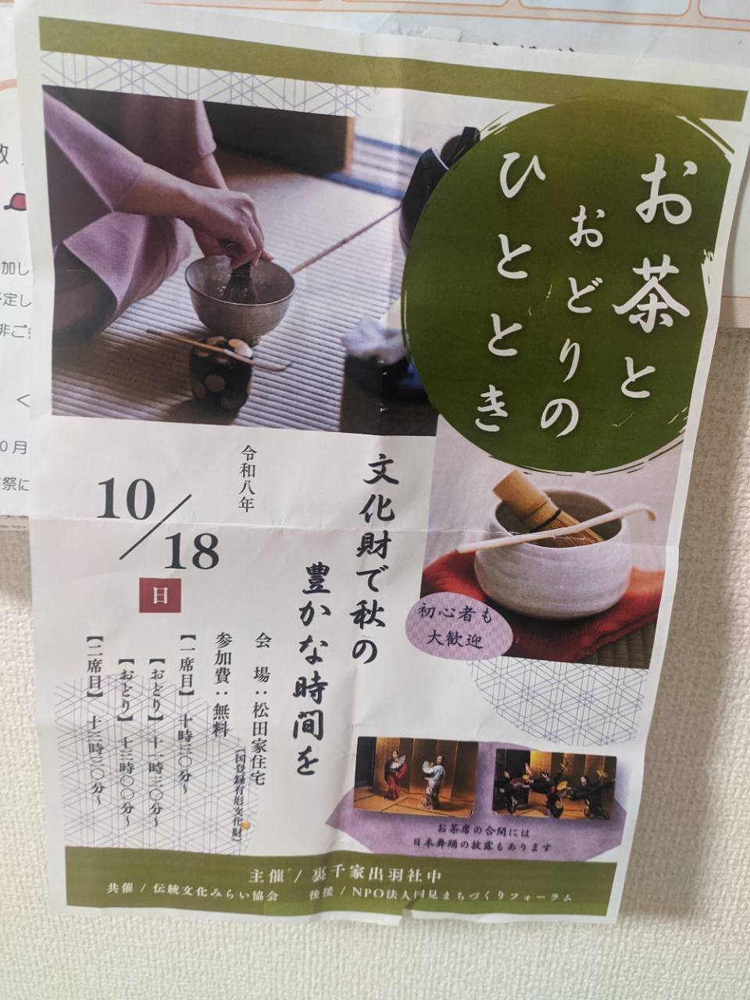

---
{"id":"nihon-buyou-20261018","title":"日本舞踊を受け継ぐ子どもたち ― お茶とおどりのひととき","published":"2026-10-19","draft":false,"period":"開催日：2026年10月18日","category":"文化・体験記","tags":["日本舞踊","伝統文化","お茶とおどりのひととき","松田家住宅"],"summary":"松田家住宅で開催された「お茶とおどりのひととき」で、花柳三寿先生のもとで学ぶ子どもたちの日本舞踊を鑑賞しました。踊りの歴史を調べながら、伝統文化を次の世代へ受け継ぐことの意味について考えました。","article_ids":[]}
---

<figure class="article-hero">

<figcaption>当日のイベントチラシ。画像を押すと原本を別タブで拡大表示できます。</figcaption>
</figure>

2026年10月18日、松田家住宅で開催された「お茶とおどりのひととき」に参加してきました。

久しぶりのお茶会でしたが、今回はお茶だけでなく、日本舞踊を鑑賞する機会にも恵まれました。

お茶会そのものも、会場となった松田家住宅も大変興味深いものでしたが、今回は特に印象に残った日本舞踊について書いてみたいと思います。

> チラシによる開催案内：2026年10月18日（日）、会場は松田家住宅。参加費は無料で、「初心者も大歓迎」と案内されていました。お茶席の合間には、日本舞踊の披露もある催しです。

## 子どもたちが披露する日本舞踊

今回、日本舞踊を披露してくださったのは、花柳三寿先生のもとで学ぶ6人の子どもたちです。

小学校3年生の子も含まれているとのことで、若い世代が日本舞踊を学んでいることに、まず興味を持ちました。

子どもたちは着物をまとい、髪を結い、かんざしを挿し、おしろいや目元の赤い化粧を施していました。

扇子やうちわなどの小道具も使いながら、四季を題材とした踊りを披露してくださいました。演目の中には「黒田節」もありました。

首の傾け方、指先の伸ばし方、手の運び方。

普段の生活ではあまり意識しないような細かな所作を、一つひとつ大切にしながら踊っている姿が印象に残りました。

## 昔の少女たちも、こうして踊っていたのだろうか

踊りを見ながら、私は一つの疑問を抱きました。

「昔の少女たちも、こうして日本舞踊を踊っていたのだろうか」

現代と昔では、子どもや大人の社会的な立場も違います。

かつては十代で結婚する女性もいたわけですから、こうした踊りを若いうちに身につけ、人前で披露することにも、今とは違う意味があったのかもしれません。

そんなことを考えながら鑑賞していました。

気になったので、帰宅後、日本舞踊の歴史について少し調べてみました。

## 日本舞踊の歴史を調べてみる

日本には古くから、神楽や舞楽、能など、さまざまな舞の文化が存在していました。

現在の日本舞踊につながる大きな流れの一つが、江戸時代に発展した歌舞伎舞踊です。

その歌舞伎の始まりをたどると、出雲の阿国という女性に行き着きます。

出雲の阿国は、江戸時代初期に「かぶき踊り」を広めた人物として知られています。

その後、歌舞伎は男性の役者を中心とする芸能へと変化し、舞踊も発展していきました。

一方、江戸時代後期以降には、舞踊が舞台の外でも習われるようになり、女性たちの芸事や教養の一つにもなっていきました。

お茶や琴、三味線などと同じように、踊りを習うことにも、さまざまな意味があったのでしょう。

今回披露された「黒田節」も、福岡藩の武士にまつわる逸話を背景に持つ民謡です。歌や踊りが長い時間をかけて受け継がれ、形を変えながら現代に伝わっていることを知りました。

こうして調べてみると、この日見た子どもたちの姿が、そのまま昔の少女たちの生活を再現しているわけではないことが分かってきました。

しかし、だからこそ、別の魅力に気づくことができました。

## 花柳三寿先生の所作

私は以前にも、花柳三寿先生の踊りを拝見したことがあります。

そのときの踊りが、大変美しかったことを覚えています。

特に印象的だったのは、腕や指先の動きでした。

例えば、腕を左から右へと動かす。

ただそれだけの動作なのに、先生が行うと、まるで周囲の空気まで一緒に動いているように感じられるのです。

空気を練るような踊り。

私には、そのように見えました。

腕が通り過ぎた後にも、何かが残っているような、不思議な余韻がありました。

今回、先生は子どもたちの踊りについて説明をされていましたが、その何気ない手の動きや膝の動きにも、以前拝見した美しい所作の面影を感じました。

長い年月をかけて身につけたものは、舞台で踊っているときだけでなく、日常のちょっとした動作にも表れるのかもしれません。

## 伝統を受け継ぐということ

今回の子どもたちの踊りを見て、改めて考えたことがあります。

それは、伝統文化を受け継ぐことの意味です。

私自身、日本舞踊について詳しいわけではありません。踊りの技術的な良し悪しを判断できるほどの知識もありません。

それでも、子どもたちが首の傾け方や指先の動きまで意識して、一生懸命に踊っていることは伝わってきました。

先生が長い時間をかけて身につけてきた所作を、今度は子どもたちが学んでいる。

そして、その子どもたちが人前で踊ることによって、私のような日本舞踊に詳しくない大人も、こうした文化に触れることができる。

考えてみれば、これはなかなか興味深いことです。

伝統文化というと、昔から続くものをそのまま保存することを想像してしまいます。

しかし、実際には、教える人がいて、学ぶ人がいて、それを見て興味を持つ人がいる。

そうした人と人との関わりの中で、文化は受け継がれていくのかもしれません。

今回の子どもたちの踊りを通じて、そのことを少し実感できたように思います。

## 素敵な時間をありがとうございました

今回のお茶会では、思いがけず日本舞踊の歴史について考える機会をいただきました。

子どもたちの踊りを見たことから始まり、歌舞伎や出雲の阿国、さらには以前読んだ世阿弥の『風姿花伝』のことまで思い出しました。

こうして一つの体験から興味が広がっていくのは、楽しいものですね。

何より、今の時代に日本舞踊を学び、人前で披露してくださる子どもたちがいることを、うれしく思いました。

花柳三寿先生、そして踊りを披露してくださった皆さん。

素晴らしい時間をありがとうございました。
